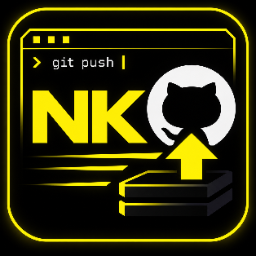
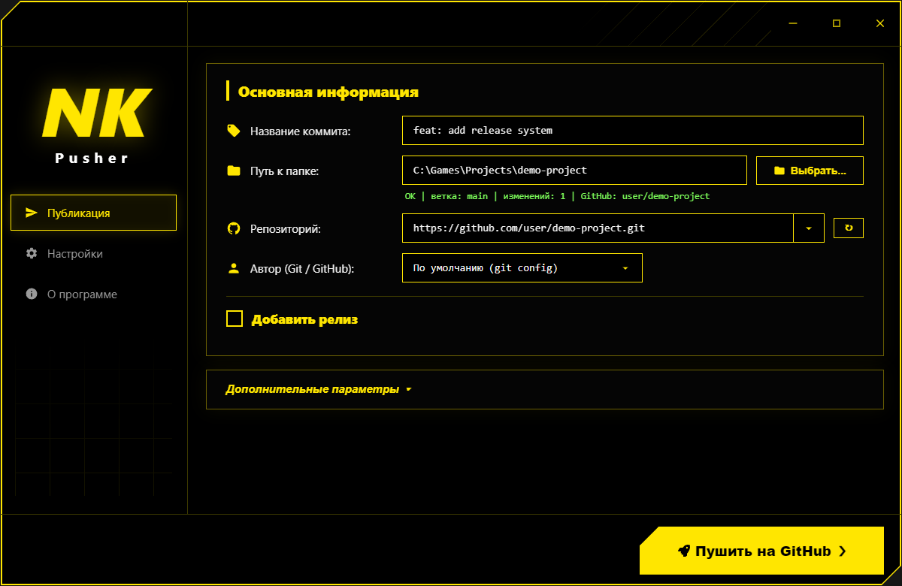
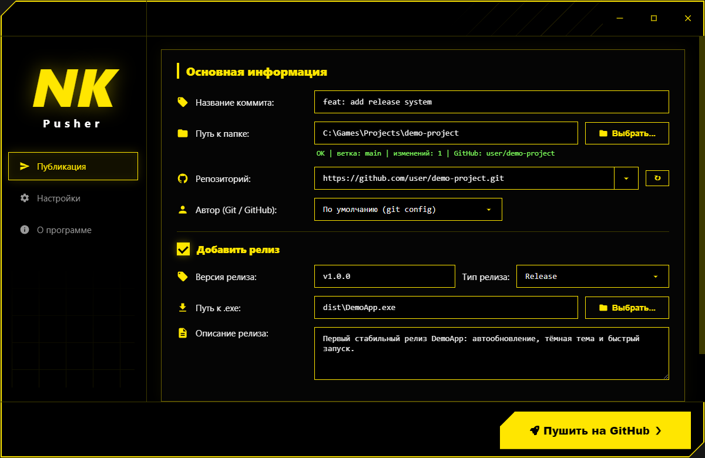
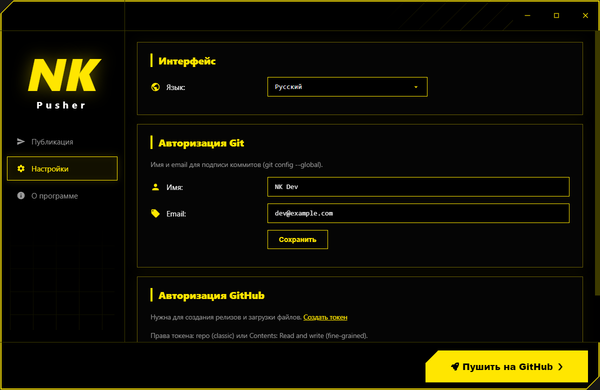
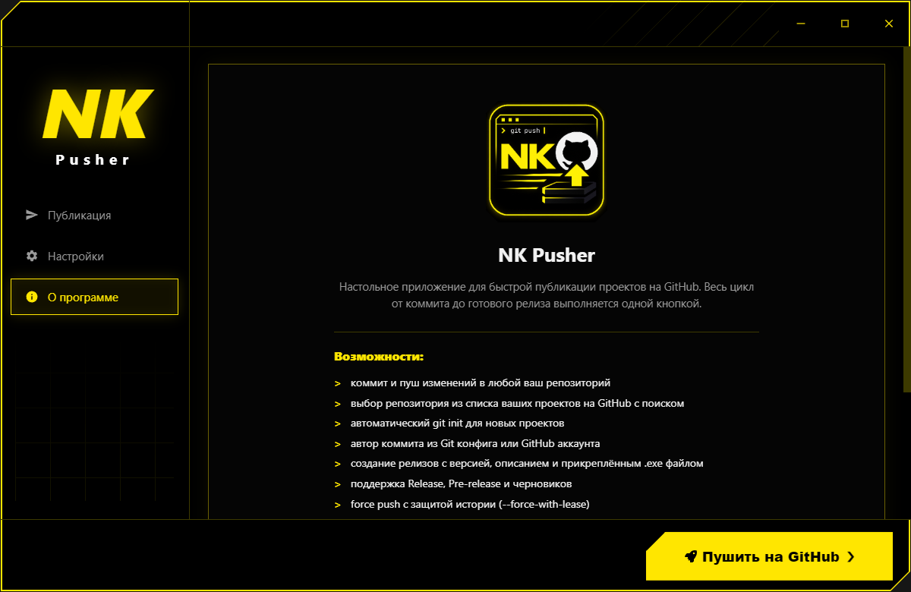
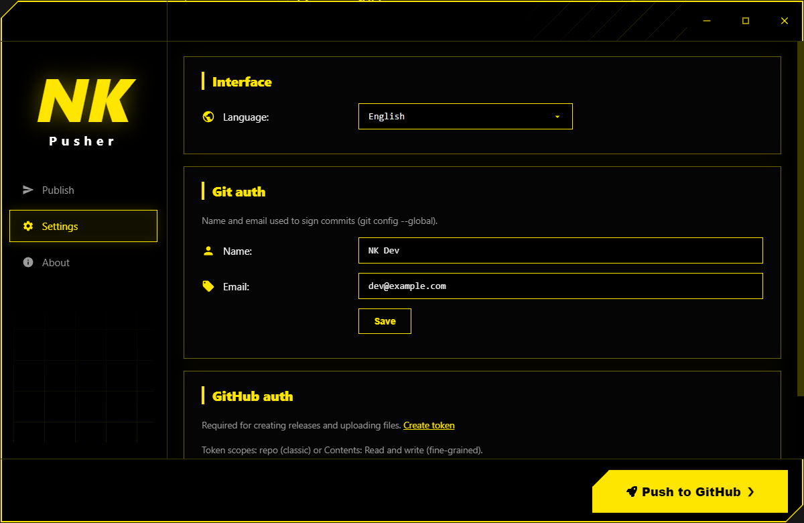

<p align="center">
  
</p>

<h1 align="center">NK Pusher</h1>

<p align="center">
  Desktop app for publishing projects to GitHub:<br>
  commit, push and release with a single button.
</p>

<p align="center">
  <a href="README.md">Русский</a> | <b>English</b>
</p>

<p align="center">
  
  
  
  
</p>

---

## Features

- Commit and push changes to any of your repositories with a single button
- Repository picker with live search across your GitHub projects
- Automatic `git init` for folders that are not a repository yet
- Commit author of your choice: from git config or your GitHub account
- Release creation: version, type (Release / Pre-release / Draft), description
- Attach a `.exe` file to the release right from the app
- Force push with history protection (`--force-with-lease`)
- Detailed log of all git operations right in the window
- Interface in three languages: Russian, English, Ukrainian
- GitHub authorization via Personal Access Token
- Yellow and black theme with a custom frameless window

## Screenshots

<p align="center">
  
</p>
<p align="center">
  
</p>
<p align="center">
  
</p>
<p align="center">
  
</p>

The interface is fully translated:

<p align="center">
  
</p>

## Quick start

Requirements: Node.js 18+ and Git.

```bash
npm install
npm start
```

## Building the installer

```bash
npm run dist
```

The ready installer will appear in the `dist` folder.

## GitHub setup

A token is required for creating releases:

1. Open [github.com/settings/tokens](https://github.com/settings/tokens)
2. Create a classic token with the `repo` scope (or a fine-grained token with `Contents: Read and write` access)
3. Paste the token in the app: Settings : GitHub auth

## Tech stack

- Electron 33
- Node.js (git child processes, no third-party runtime npm dependencies)
- GitHub REST API (releases, asset uploads, repository list)

## License

Closed source. Copying, distribution and use without the author's written
permission is prohibited. See [LICENSE](LICENSE) for details.
