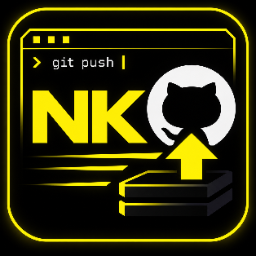
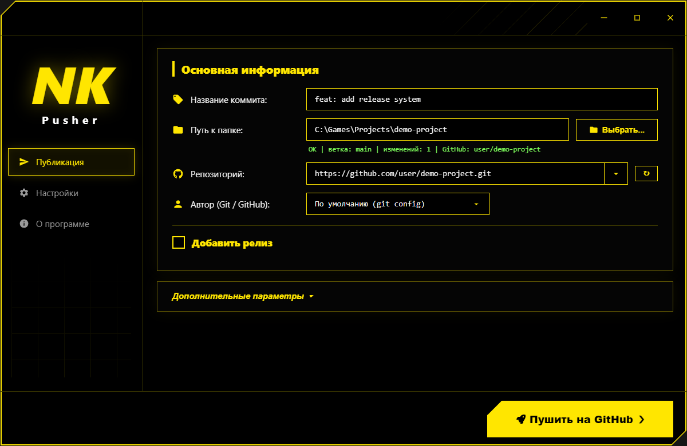
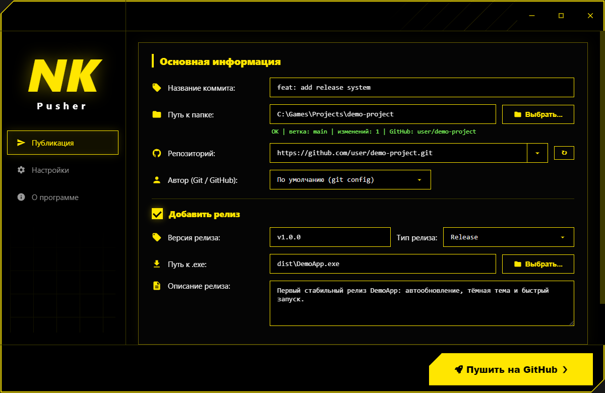
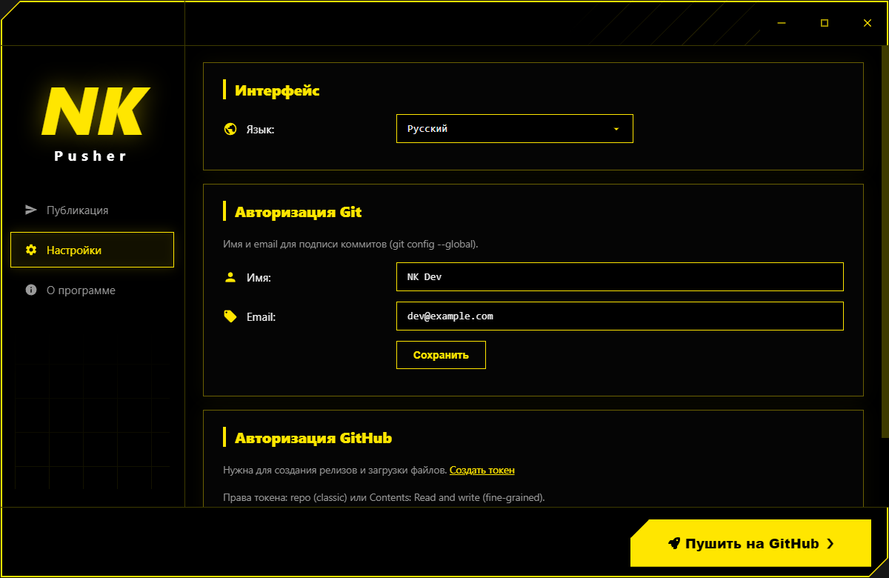
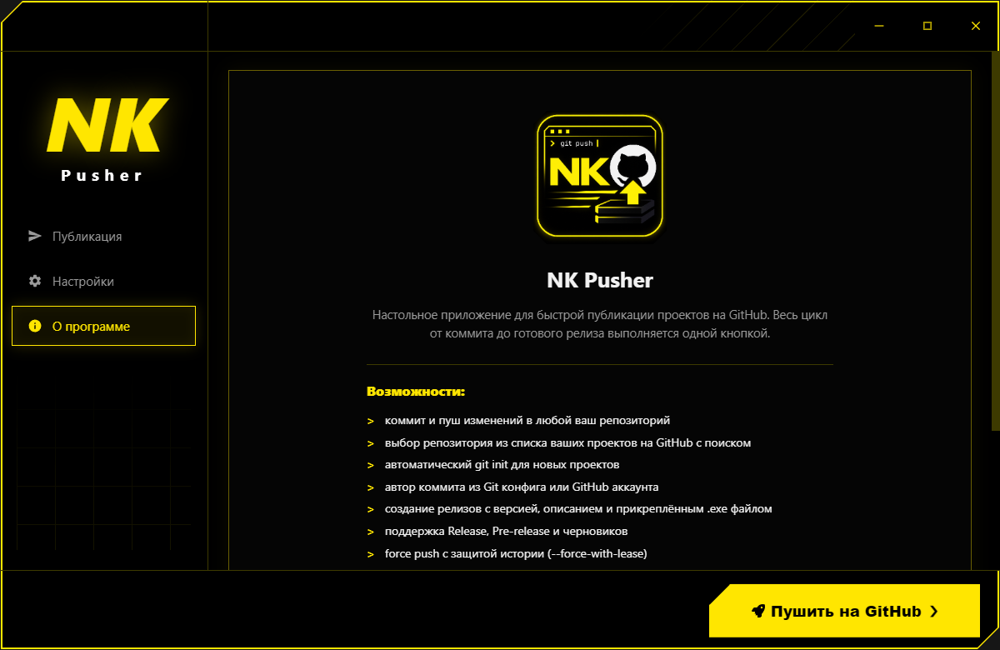
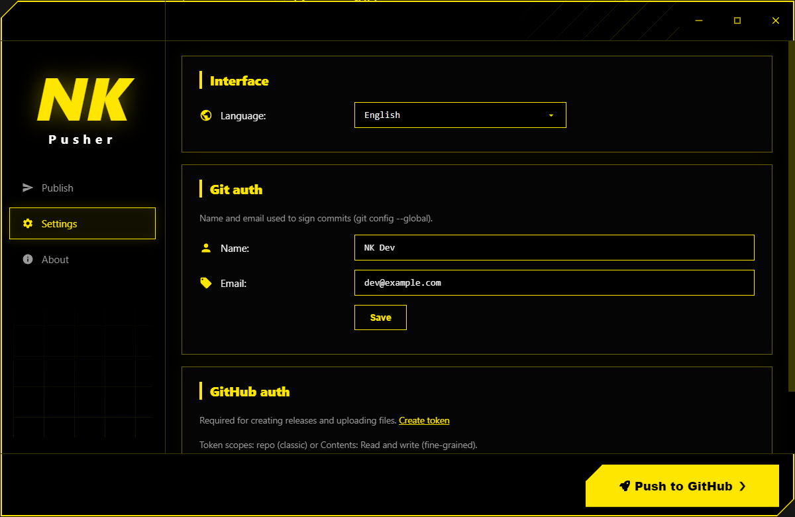

<p align="center">
  
</p>

<h1 align="center">NK Pusher</h1>

<p align="center">
  Настольное приложение для публикации проектов на GitHub:<br>
  коммит, пуш и релиз одной кнопкой.
</p>

<p align="center">
  
  
  
  
</p>

---

## Возможности

- Коммит и пуш изменений в любой ваш репозиторий одной кнопкой
- Выбор репозитория из списка ваших проектов на GitHub с живым поиском
- Автоматический `git init` для папок, которые ещё не являются репозиторием
- Автор коммита на выбор: из git config или из аккаунта GitHub
- Создание релизов: версия, тип (Release / Pre-release / Черновик), описание
- Прикрепление `.exe` файла к релизу прямо из приложения
- Force push с защитой истории (`--force-with-lease`)
- Подробный лог всех операций git прямо в окне
- Интерфейс на трёх языках: русский, английский, украинский
- Авторизация GitHub через Personal Access Token
- Жёлто-чёрная тема и кастомное окно без системной рамки

## Скриншоты

<p align="center">
  
</p>
<p align="center">
  
</p>
<p align="center">
  
</p>
<p align="center">
  
</p>

Интерфейс полностью переведён:

<p align="center">
  
</p>

## Быстрый старт

Требования: Node.js 18+ и Git.

```bash
npm install
npm start
```


## Настройка GitHub

Для создания релизов нужен токен:

1. Откройте [github.com/settings/tokens](https://github.com/settings/tokens)
2. Создайте classic токен с правом `repo` (или fine-grained токен с доступом `Contents: Read and write`)
3. Вставьте токен в приложении: Настройки : Авторизация GitHub

## Технологии

- Electron 33
- Node.js (дочерние процессы git, без сторонних npm-зависимостей в рантайме)
- GitHub REST API (релизы, загрузка ассетов, список репозиториев)

## Лицензия

Закрытый исходный код. Копирование, распространение и использование
без письменного разрешения автора запрещены. Подробности в файле [LICENSE](LICENSE).
